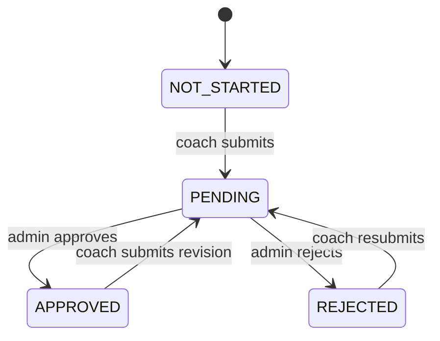

# PRD — TYC Admin Web

**Platform:** Web Admin  
**Recommended Frontend/Full-stack Framework:** Next.js  
**Primary Data Store:** PostgreSQL  
**ORM:** Drizzle ORM  
**Document Status:** Draft for implementation  
**Basis:** Notion task tracker supplied by the user, with explicit gaps/technical recommendations marked separately.

---

## 1. Product Overview

TYC Admin Web is the operational backoffice for managing tournaments that are consumed by the TYC mobile application.

The admin web is responsible for the source-of-truth data used by the mobile app, including:

- tournaments;
- age groups;
- group stages and playoff/cup stages;
- teams;
- coach assignments and coach-submitted data approvals;
- players;
- schedules and match statuses;
- live score and goal events;
- standings and team statistics;
- highlights/video;
- football news;
- venue/pitch data;
- tournament rules;
- certificate configuration;
- notifications;
- dashboard and reports.

The Notion tracker explicitly requires roles `Super Admin` and `Operator` for the web admin, with different module access.

---

## 2. Product Goals

1. Provide one operational console for tournament staff.
2. Ensure mobile data comes from one consistent backend source.
3. Reduce manual errors in scheduling, team setup, score entry, standings, and statistics.
4. Provide approval workflows for coach-submitted team data.
5. Provide near-real-time visibility of live matches.
6. Maintain a traceable history for critical changes such as score corrections and player transfers.
7. Support export/reporting for tournament operations.
8. Allow content publishing for news, highlights, rules, certificates, and notifications.

---

## 3. Users and Roles

### 3.1 Super Admin

Expected capabilities:

- full access to all modules;
- manage admin accounts and roles;
- configure tournaments;
- manage master and operational data;
- approve/reject coach submissions;
- manage live score;
- publish content;
- view reports and audit history.

### 3.2 Operator

The tracker specifies that Operator has different module permissions, but does not define the exact permission matrix.

**Required product decision:** define a permission matrix before release.

Recommended initial permissions:

| Module | Super Admin | Operator |
|---|---:|---:|
| Dashboard | Full | View |
| Tournament Setup | Full | Configurable |
| Age Group | Full | Configurable |
| Groups / Playoff | Full | Configurable |
| Teams | Full | Full |
| Coaches / Approval | Full | Full |
| Players | Full | Full |
| Schedule | Full | Full |
| Live Score | Full | Full |
| Highlights | Full | Full |
| News | Full | Full |
| Venues | Full | Configurable |
| Tournament Rules | Full | Configurable |
| Certificates | Full | Configurable |
| Notifications | Full | Full |
| Admin Account / Role | Full | None |
| Audit Log | Full | View if permitted |

---

## 4. Product Scope

### 4.1 In Scope

The following 16 admin modules are directly represented in the Notion task tracker:

1. Tournament Setup
2. Group Stage / Playoff Stage
3. Teams
4. Age Groups
5. Admin Authentication & Account Management
6. Coach Management & Team Data Approval
7. Players
8. Match Schedule
9. Live Score / Results / Goals
10. Highlights / Video
11. Football News
12. Venue / Pitch
13. Tournament Rules
14. Certificate
15. Dashboard & Reports
16. Notification Management

### 4.2 Supporting Capabilities Required for Production

These are implementation necessities derived from the requested features, but are not fully broken down in the tracker:

- role and permission enforcement;
- audit log;
- file/media storage;
- email delivery for password reset;
- push notification delivery integration;
- API for React Native mobile;
- validation and data integrity;
- background jobs/outbox;
- system observability;
- backups and database migration;
- application configuration.

---

# 5. Functional Requirements

## 5.1 Admin Authentication & Account Management

### Requirements

- Admin can log in using email and password.
- Valid login redirects to Dashboard.
- Invalid credentials show a generic authentication error that does not reveal whether email or password was incorrect.
- Unauthenticated access to internal URLs redirects to Login.
- Forgot Password uses an email reset link.
- Admin can have different roles such as Super Admin and Operator.
- Login session automatically expires after a configurable inactivity period.

### Recommended additions

- account active/inactive status;
- password reset token expiry;
- forced logout after account deactivation;
- last login information;
- failed login throttling;
- admin-created accounts only for initial release.

### Acceptance criteria

- Protected pages cannot be opened without a valid session.
- Deactivated users cannot authenticate.
- Password reset links are single-use and expire.
- Permission checks apply server-side, not only through hidden UI.

---

# 5.2 Dashboard & Reports

### Dashboard metrics

The tracker requires:

- Total Teams;
- Total Players;
- Matches Today;
- Live Matches;
- Active Groups.

### Operational attention panel

Display teams whose setup requires action:

- Coach confirmation pending;
- Jersey colours pending;
- Player registration incomplete/warning.

### Reporting

Admin can export examples such as:

- standings;
- match schedules;
- player lists;

to:

- Excel;
- PDF.

### Data freshness

Dashboard should update in near-real-time.

Recommended MVP:
- auto refresh every 15–30 seconds for live metrics;
- manual refresh;
- no WebSocket dependency required for first release.

---

# 5.3 Tournament Setup

### Fields

- Tournament Name
- Logo/Banner
- Start Date
- End Date
- Description

### Status

- Draft
- Published
- Archived / Finished

### Business rules

- Draft tournaments are not visible in the mobile application.
- End Date cannot be earlier than Start Date.
- Tournament can be edited.
- Tournament can only be deleted when it has not started and has no related result data.
- Otherwise use archival/deactivation instead of destructive deletion.

### List capabilities

- search;
- status filter;
- pagination.

---

# 5.4 Age Group Management

### Capabilities

Admin can:

- create;
- edit;
- delete;
- set display order.

### Fields

- Tournament
- Name, for example `Under 11`
- Sort Order
- Active Status

### Rules

- Cannot delete an age group that already contains groups or registered teams.
- New age groups automatically appear when creating Group/Stage data.

### Important product note

The mobile/Figma sources contain different example age values (`U15` vs `U19` in different artifacts). Age groups therefore **must be dynamic backend data**, never hard-coded in web or mobile.

---

# 5.5 Group Stage & Playoff Stage Management

### Capabilities

Admin can:

- create a group/stage under an age group;
- define stage type:
  - Group Stage;
  - Playoff / Cup Stage;
- add/remove teams;
- view matches belonging to the group/stage;
- view calculated standings;
- manually override display/ranking order for special tie-break cases.

### Standings displayed in the current product scope

- Team
- Played
- Goal Difference
- Points

### Business rules

- Standings are recalculated from finalized match results.
- Manual ranking override must be traceable.
- Mobile consumes the official server-provided ranking and must not calculate standings locally.

---

# 5.6 Team Management

### Fields

- Team Name
- Logo
- Sport
- Age Group
- Group
- Home Jersey
- Away Jersey
- Active Status
- Max Squad Size

### Sport

The tracker explicitly mentions multi-sport examples:

- Football
- Basketball
- Baseball
- Volleyball
- etc.

However, current standings, goals, and statistics requirements are football-specific.

**Product gap:** sport-specific scoring, standings, event, and statistics rules for non-football sports are not defined.

Recommended scope decision:

- store `sport` as domain data from the start;
- support Football rules in MVP;
- do not claim full multi-sport tournament logic until rules for the other sports are specified.

### Team capabilities

- search by name;
- filter by age group, group, and sport;
- view/manage players;
- view generated statistics;
- set jersey colours directly;
- receive coach-submitted jersey colours as Pending Review;
- deactivate a withdrawn team.

### Delete/deactivate rule

If a team already has scheduled matches, destructive deletion must be blocked; use inactive/withdrawn status instead.

---

# 5.7 Coach Management & Team Data Approval

### Coach assignment

Admin can assign one or more coach accounts to a team.

A coach may manage multiple teams.

### Team setup status

Admin sees:

- Confirm Coach: approved / pending / rejected;
- Jersey Colours: approved / pending / rejected;
- Player Registration: approved / pending / warning/incomplete.

### Coach name submission

Admin can:

- inspect Coach 1 / Coach 2 submitted from mobile;
- edit if permitted by business policy;
- approve;
- reject;
- provide rejection reason.

### Jersey submission

Coach-submitted home/away colours remain Pending Review until approved.

### Max Squad

Admin configures Max Squad Size.

System derives:

- Player Registered;
- Slots Remaining.

### Notifications

Coach receives a notification when a submission is rejected or needs revision.

---

# 5.8 Player Management

### Fields

- Name
- Photo
- Position
- Jersey Number
- Team

### Capabilities

Admin can:

- create;
- edit;
- delete when allowed;
- filter by team and age group;
- search by player name;
- approve/reject players submitted from the coach mobile workflow;
- transfer a player between teams.

### Rules

- Jersey number must be unique within the same team.
- Player count cannot exceed Max Squad Size.
- Transfer must preserve history.

### Recommended transfer record

Store:

- previous team;
- new team;
- changed by;
- timestamp;
- reason/note where applicable.

---

# 5.9 Match Schedule

### Manual data

A match requires at least:

- tournament;
- age group;
- stage/group;
- home team;
- away team;
- date;
- start time;
- venue/pitch;
- duration;
- status.

### Status

- Scheduled
- Live
- Finished
- Postponed
- Cancelled

### Automatic schedule generation

Tracker requirement:

Admin supplies:

- teams;
- match duration;
- rest/buffer duration;
- number/selection of pitches;

and the system generates the schedule.

### Conflict detection

System warns about:

- same venue/pitch used at overlapping time;
- same team playing at overlapping time.

Recommended additional validation:

- home and away team cannot be identical;
- both teams must belong to the selected competition context;
- match must be inside tournament dates;
- minimum team rest period where configured.

### Reschedule

Admin can change:

- date;
- time;
- venue.

A reschedule triggers notifications to:

- coaches of related teams;
- users who have related teams as favorites.

### List filters

- date;
- age group;
- group;
- status.

---

# 5.10 Live Score, Results & Goals

### Score entry

Admin can update:

- Home Score
- Away Score

### Goal entry

Each goal event contains:

- player;
- team;
- minute.

The goal appears in the mobile Match Detail Goals section.

### Live support

For Live matches:

- score can change during the match;
- goal events can be added/edited;
- mobile can receive fresh data through polling/realtime API.

### Finalization

When status becomes `Finished`:

System automatically updates:

- standings;
- Played;
- Goal Difference;
- Points;
- team Total Matches;
- Matches Won;
- Goals Scored.

### Correction

Admin may correct score and goal data after entry.

All corrections must be logged in the audit trail.

### Recommended product rule

Finalizing/correcting match results must be a single transactional operation so score, events, standings, and team statistics cannot become inconsistent.

---

# 5.11 Highlights / Video

### Data

- Title
- Thumbnail
- Video source:
  - uploaded file; or
  - external video URL
- Match relation
- Optional Player relation
- Sort Order
- Publish Status

### Capabilities

- create/upload/link;
- preview;
- publish/unpublish;
- reorder;
- replace;
- delete if allowed.

### Validation

Supported format and maximum file size must be configured before production.

---

# 5.12 Football News

### Fields

- Title
- Cover Image
- Rich Text Content
- Category
- Publish Date
- Status

### Status

- Draft
- Published

### Rules

- Draft articles never appear in mobile.
- Admin can search/filter article list.
- Admin can edit published articles.
- Delete behavior should be restricted if historical URLs/deep-links need preservation; soft-delete is recommended.

---

# 5.13 Venue / Pitch

### Fields

- Name
- Address
- Capacity — optional
- Map Location — optional
- Active Status

### Rules

- Venue already referenced by match schedules cannot be deleted.
- It can be deactivated instead.
- List supports search/filter.

---

# 5.14 Tournament Rules

### Content options

- rich text;
- uploaded PDF.

### Requirements

- publish rules to mobile;
- keep version information;
- keep last-updated timestamp.

### Recommended addition

Store published version separately from draft version so incomplete edits do not unexpectedly replace the active mobile rules.

---

# 5.15 Certificate

### Admin capabilities

- configure/upload certificate template;
- configure tournament logo/layout;
- enable/disable availability:
  - by match;
  - by team.

### Generated content requested by tracker

Certificate can contain:

- Team Name
- Player Name
- Winner designation where applicable
- Participant designation otherwise
- Match/Tournament Date

### Mobile integration

Mobile requests certificate generation/download only when certificate availability is enabled.

### Product gap

Exact certificate recipient rules and design template system are not fully defined in the source tracker and must be finalized before implementation.

---

# 5.16 Notification Management

### Manual notification

Admin can create:

- Title
- Message
- Target

Targets:

- all users;
- users following a specific favorite team.

### Automatic notifications

The tracker explicitly requires automatic notification when:

- schedule changes;
- match becomes Live;
- final result is entered.

Coach rejection/revision notifications are also required by the coach approval module.

### History

Admin can view sent notification history.

Recommended statuses:

- queued;
- processing;
- sent;
- partially_failed;
- failed.

---

# 6. Approval Workflow

The web tracker requires Pending Review for coach-submitted data, while some mobile tasks currently say the checklist becomes complete immediately after Save.

For platform consistency, use this canonical state machine:

Applicable to:

- Coach Names
- Jersey Colours
- Player Registration

The mobile application must be adjusted accordingly; see the separate mobile adjustment document.

---

# 7. Core Business Rules

1. Mobile shows only Published tournament/content.
2. Server is source of truth for official standings.
3. Match finalization recalculates standings/statistics.
4. Manual standings override is auditable.
5. Coach-submitted data requires admin approval.
6. Jersey number is unique per team.
7. Max Squad Size is enforced on the server.
8. A team/venue with operational references should normally be deactivated, not hard-deleted.
9. Match score corrections require audit logging.
10. Unauthorized roles cannot invoke restricted server operations.
11. Reschedule sends targeted notifications.
12. Live status becomes visible to mobile.
13. Draft news/rules/tournament data must not leak into public mobile APIs.

---

# 8. Non-Functional Requirements

## Security

- HTTPS only.
- Secure, HTTP-only admin session cookies.
- Server-side authorization for every mutation.
- Strong password hashing.
- Rate limiting/throttling for authentication.
- No credentials, tokens, or sensitive personal data in logs.
- File upload MIME/type/size validation.
- Audit critical operations.

## Performance

Recommended targets:

- normal admin list interaction: perceived response under ~2 seconds under expected load;
- search/filter should be server-paginated for large datasets;
- live score updates visible to mobile within the agreed refresh window;
- dashboard near-real-time without full-page reload.

## Reliability

- transactional updates for match finalization;
- database constraints for key integrity;
- retryable notification jobs;
- idempotent background processing where possible.

## Accessibility

- keyboard accessible admin UI;
- semantic forms and labels;
- visible focus state;
- adequate contrast;
- accessible data tables.

## Maintainability

- feature/domain-oriented code;
- typed server contracts;
- migration-controlled schema;
- automated tests for critical business rules.

---

# 9. Audit Requirements

Minimum audited actions:

- score create/update;
- goal create/update/delete;
- match status change;
- schedule/reschedule;
- standings manual override;
- coach approval/rejection;
- player approval/rejection;
- player transfer;
- team activation/deactivation;
- role/permission changes;
- content publish/unpublish.

Audit entry should contain:

- actor;
- action;
- entity type;
- entity id;
- old value;
- new value;
- timestamp;
- optional reason.

---

# 10. Product Analytics / Operational Metrics

Admin operations:

- number of active tournaments;
- pending coach approvals;
- pending jersey approvals;
- pending player approvals;
- live matches;
- failed notification jobs;
- incomplete team setups.

Mobile-impact metrics can be collected separately:

- live match opens;
- favorite team count;
- notification open rate;
- certificate download count.

---

# 11. Out of Scope / Not Fully Defined

The following are not sufficiently defined by the supplied task tracker:

- complete sport-specific rules for Basketball/Baseball/Volleyball;
- complex knockout bracket seeding logic;
- referee administration;
- payment;
- ticketing;
- chat;
- advanced analytics/statistics;
- detailed certificate designer behavior;
- exact push provider;
- exact media storage provider;
- multilingual content;
- public web portal.

These should not be silently assumed.

---

# 12. Recommended Delivery Phases

## Phase 0 — Foundation

- Next.js project
- database/Drizzle
- authentication
- RBAC
- shared design system
- audit infrastructure
- file storage abstraction
- mobile API foundation
- CI/CD

## Phase 1 — Tournament Core

- Tournament
- Age Group
- Group/Stage
- Team
- Venue/Pitch

## Phase 2 — Participant Operations

- Coach assignment
- Team setup approval
- Players
- Max Squad
- Transfer history

## Phase 3 — Match Operations

- Match scheduling
- Automatic schedule generation
- conflict detection
- Live Score
- Goals
- Finalization
- Standings
- Team Stats
- Audit

## Phase 4 — Content

- Highlights
- News
- Tournament Rules
- Certificate

## Phase 5 — Notifications & Reports

- manual notifications
- automatic events
- delivery history
- dashboard
- exports

## Phase 6 — Hardening

- security review
- performance
- accessibility
- E2E
- backup/recovery validation
- production monitoring

---

# 13. Definition of Done

A module is complete when:

- UI follows approved admin design;
- authorization is enforced server-side;
- validation and error states exist;
- database constraints exist where applicable;
- list search/filter/pagination works where required;
- audit exists for critical writes;
- automated test coverage exists for business-critical rules;
- mobile-facing changes are reflected in versioned API;
- no draft/unapproved data leaks into public mobile responses;
- QA acceptance criteria pass.
