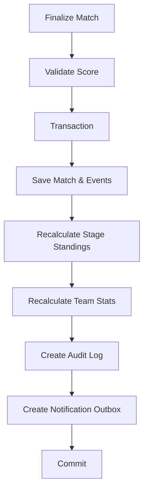

# Technical Design — TYC Admin Web

**Framework:** Next.js  
**ORM:** Drizzle ORM  
**Database:** PostgreSQL  
**Language:** TypeScript  
**Architecture Target:** Modular monolith with mobile-facing API  
**Document Status:** Draft for implementation

---

# 1. Architecture Objectives

The system should:

1. serve the Admin Web;
2. expose versioned APIs to the React Native mobile app;
3. keep business logic in a shared domain/service layer;
4. use PostgreSQL as the system of record;
5. use Drizzle ORM and migrations;
6. preserve strong transactional integrity for matches, standings, and approvals;
7. support near-real-time live score consumption without requiring WebSocket infrastructure in the first release;
8. support future extraction of heavy jobs/services if growth requires it.

---

# 2. Recommended High-Level Architecture

```mermaid
flowchart LR
    A[Admin Browser] --> N[Next.js Admin Web]
    M[React Native Mobile] --> API[/api/v1/*]

    N --> S[Application / Domain Services]
    API --> S

    S --> D[Drizzle ORM]
    D --> P[(PostgreSQL)]

    S --> O[Object Storage]
    S --> E[Email Provider]
    S --> Q[Outbox / Background Worker]
    Q --> PUSH[Push Provider]
    Q --> DOC[Certificate / Export Jobs]
```

### Architectural decision

Use a **modular monolith** first.

Reasons:

- the domains are strongly related;
- one transaction often touches multiple tournament entities;
- easier deployment for a small team;
- simpler observability;
- Drizzle transactions can protect consistency;
- services can still be extracted later if necessary.

---

# 3. Next.js Application Structure

Use the App Router.

Suggested structure:

```text
src/
├── app/
│   ├── (auth)/
│   │   ├── login/
│   │   └── forgot-password/
│   ├── (admin)/
│   │   ├── dashboard/
│   │   ├── tournaments/
│   │   ├── age-groups/
│   │   ├── stages/
│   │   ├── teams/
│   │   ├── coaches/
│   │   ├── players/
│   │   ├── matches/
│   │   ├── live-score/
│   │   ├── highlights/
│   │   ├── news/
│   │   ├── venues/
│   │   ├── rules/
│   │   ├── certificates/
│   │   ├── notifications/
│   │   ├── reports/
│   │   └── audit/
│   └── api/
│       └── v1/
│           ├── auth/
│           ├── home/
│           ├── tournaments/
│           ├── groups/
│           ├── teams/
│           ├── matches/
│           ├── favorites/
│           ├── coach/
│           ├── news/
│           ├── notifications/
│           └── certificates/
│
├── modules/
│   ├── auth/
│   ├── users/
│   ├── tournaments/
│   ├── competitions/
│   ├── teams/
│   ├── coaches/
│   ├── players/
│   ├── scheduling/
│   ├── matches/
│   ├── standings/
│   ├── content/
│   ├── certificates/
│   ├── notifications/
│   └── audit/
│
├── db/
│   ├── schema/
│   ├── migrations/
│   ├── client.ts
│   └── seed/
│
├── components/
├── lib/
│   ├── auth/
│   ├── permissions/
│   ├── storage/
│   ├── validation/
│   ├── observability/
│   └── jobs/
│
└── types/
```

Each module should own:

```text
schema.ts
repository.ts
service.ts
validation.ts
permissions.ts
types.ts
tests/
```

Do not put domain logic directly inside React components or route handlers.

---

# 4. Data Access with Drizzle ORM

## 4.1 Principles

- PostgreSQL constraints are part of business integrity.
- Drizzle schema is the canonical application schema.
- Every schema change goes through migration.
- Avoid direct ad-hoc SQL from UI/server actions unless needed for optimized reports.
- Critical workflows use database transactions.

## 4.2 Example database connection

```ts
import { drizzle } from "drizzle-orm/node-postgres";
import { Pool } from "pg";

const pool = new Pool({
  connectionString: process.env.DATABASE_URL,
});

export const db = drizzle(pool);
```

Production implementation may use the database driver appropriate to the actual hosting environment.

---

# 5. Core Database Model

## 5.1 Authentication and RBAC

Recommended tables:

```text
users
roles
permissions
user_roles
role_permissions
admin_sessions
password_reset_tokens
```

Suggested role seeds:

```text
SUPER_ADMIN
OPERATOR
COACH
USER
```

`COACH` and `USER` primarily support mobile/API identities; admin access is granted only by permissions.

---

## 5.2 Tournament

```text
tournaments
- id
- name
- slug
- description
- logo_url
- banner_url
- starts_at
- ends_at
- status
- created_at
- updated_at
- archived_at
```

Status:

```text
DRAFT
PUBLISHED
ARCHIVED
```

---

## 5.3 Sport

Because the source tracker requests multi-sport:

```text
sports
- id
- code
- name
- active
```

Examples:

```text
FOOTBALL
BASKETBALL
BASEBALL
VOLLEYBALL
```

### Important limitation

The current scoring/standings requirements only define football concepts.

Recommended implementation:

- model Sport from day one;
- implement `FootballCompetitionRules` for MVP;
- define a `CompetitionRules` interface;
- reject unsupported sport-specific scheduling/scoring configurations until explicit rules are defined.

---

## 5.4 Age Group

```text
age_groups
- id
- tournament_id
- name
- sort_order
- active
```

Recommended unique constraint:

```text
(tournament_id, name)
```

---

## 5.5 Stage / Group

```text
competition_stages
- id
- tournament_id
- age_group_id
- name
- type
- sort_order
- active
```

Type:

```text
GROUP
PLAYOFF
CUP
```

Team memberships:

```text
stage_teams
- stage_id
- team_id
- seed
- created_at
```

---

## 5.6 Team

```text
teams
- id
- tournament_id
- sport_id
- age_group_id
- name
- logo_url
- home_jersey_name
- home_jersey_hex
- away_jersey_name
- away_jersey_hex
- max_squad_size
- status
- created_at
- updated_at
```

Possible status:

```text
ACTIVE
WITHDRAWN
INACTIVE
```

Group/stage membership should be relation data rather than a hard-coded single `group_id` if future tournaments need more flexibility.

---

# 6. Coach Assignment and Approval Model

## 6.1 Coach assignment

```text
coach_team_assignments
- id
- coach_user_id
- team_id
- active
- assigned_by
- assigned_at
```

Unique active relationship should be enforced as appropriate.

## 6.2 Team setup submission

Use a common workflow model or dedicated submission tables.

Recommended dedicated records:

```text
coach_name_submissions
jersey_submissions
player_submissions
```

Common state:

```text
PENDING
APPROVED
REJECTED
```

Common metadata:

```text
submitted_by
submitted_at
reviewed_by
reviewed_at
rejection_reason
revision
```

### Why not save directly to Team?

Because the tracker requires coach-submitted jersey and player data to remain pending until admin review.

For approved jersey data:

1. coach submits;
2. create `jersey_submissions` PENDING;
3. admin approves;
4. in one transaction:
   - update `teams.home_jersey_*`;
   - update `teams.away_jersey_*`;
   - mark submission APPROVED;
   - create audit entry;
   - create notification outbox event.

---

# 7. Player Model

```text
players
- id
- team_id
- name
- photo_url
- position
- jersey_number
- status
- created_at
- updated_at
```

Recommended status:

```text
ACTIVE
INACTIVE
TRANSFERRED
```

### Unique jersey rule

Database uniqueness:

```text
UNIQUE(team_id, jersey_number)
```

If soft-deleted/inactive records must reuse jersey numbers, use a partial unique index or model active roster memberships separately.

### Transfer

Prefer roster/history tables for long-term integrity:

```text
player_team_history
- id
- player_id
- from_team_id
- to_team_id
- changed_by
- changed_at
- note
```

---

# 8. Match Model

```text
matches
- id
- tournament_id
- age_group_id
- stage_id
- home_team_id
- away_team_id
- venue_id
- starts_at
- scheduled_duration_minutes
- buffer_minutes
- status
- home_score
- away_score
- match_minute
- referee_name
- version
- created_at
- updated_at
- finalized_at
```

Status:

```text
SCHEDULED
LIVE
FINISHED
POSTPONED
CANCELLED
```

Validation:

- home != away;
- both teams are valid for competition context;
- match datetime within tournament window unless explicitly overridden;
- no team/venue overlap.

---

# 9. Match Events

Do not model goals as fixed columns.

```text
match_events
- id
- match_id
- event_type
- team_id
- player_id
- minute
- sort_order
- metadata_json
- created_by
- created_at
- updated_at
```

MVP event types:

```text
GOAL
```

Future football extension:

```text
OWN_GOAL
YELLOW_CARD
RED_CARD
SUBSTITUTION
PENALTY
```

This model supports the mobile Match Detail Goals section and future event timelines.

---

# 10. Standings Model

Recommended materialized/derived table:

```text
standings
- id
- stage_id
- team_id
- position
- played
- wins
- draws
- losses
- goals_for
- goals_against
- goal_difference
- points
- manual_rank_override
- calculated_at
```

Although the current mobile UI displays only:

```text
Team
P
GD
PTS
```

store the complete football calculation to avoid rework.

## 10.1 Calculation

When a match changes to FINISHED:



Never ask the client to calculate official standings.

## 10.2 Manual override

If admin overrides rank:

- save `manual_rank_override`;
- preserve calculated rank separately if useful;
- audit actor/reason/old/new values.

---

# 11. Team Statistics

Required by mobile/Notion:

```text
Total Matches
Matches Won
Goals Scored
```

Can be:

- computed on query for low volume;
- maintained in a derived table for faster dashboard/mobile.

Recommended table:

```text
team_statistics
- team_id
- total_matches
- matches_won
- matches_drawn
- matches_lost
- goals_scored
- goals_conceded
- updated_at
```

Update only through match finalization/correction service.

---

# 12. Scheduling Engine

The tracker requires automatic schedule creation.

## 12.1 Input

```text
teams
available pitches
tournament/date window
match duration
buffer/rest duration
stage/group
```

## 12.2 MVP algorithm

Recommended:

1. generate required pairings;
2. generate available time slots per pitch;
3. iterate pairings;
4. assign earliest slot satisfying:
   - pitch available;
   - home team available;
   - away team available;
   - configured rest/buffer;
5. if no valid slot:
   - mark schedule generation incomplete;
   - return conflict diagnostics;
6. show generated schedule in preview;
7. admin confirms before persistence.

Do not auto-commit a large generated schedule without review.

## 12.3 Conflict service

A reusable function should validate:

```ts
checkMatchConflicts({
  startsAt,
  endsAt,
  venueId,
  homeTeamId,
  awayTeamId,
  excludeMatchId,
})
```

Database-side overlap constraints may be added depending on final scheduling rules, but application validation is still required for useful error messages.

---

# 13. Authentication

## 13.1 Admin Web

Recommended:

- session cookie;
- `HttpOnly`;
- `Secure`;
- appropriate `SameSite`;
- server-side session lookup;
- inactivity timeout.

Auth.js may be used, or a custom session implementation if operational constraints require it.

Do not store admin bearer tokens in browser localStorage.

## 13.2 Mobile API

Mobile should use a token-based API session suitable for React Native:

- short-lived access token;
- refresh token;
- secure device storage.

The same user identity/permission system can back both web and mobile even though session mechanisms differ.

---

# 14. Authorization

Use explicit permissions rather than role-name checks scattered across code.

Example:

```text
tournament.read
tournament.write
team.read
team.write
coach.review
player.review
match.schedule
match.score
content.publish
notification.send
admin.manage
audit.read
```

Service example:

```ts
await requirePermission(session.userId, "match.score");
await matchService.finalizeMatch(input);
```

Client-side hidden buttons are UX only; backend service/route authorization is mandatory.

---

# 15. Validation

Recommended:

- Zod schemas at server boundaries;
- PostgreSQL constraints for invariants;
- business checks in services.

Examples:

```text
end_date >= start_date
home_team != away_team
jersey number unique per team
registered players <= max_squad_size
cannot delete referenced venue
cannot expose DRAFT content through public APIs
```

---

# 16. API Design for Mobile

Use versioned JSON APIs:

```text
/api/v1
```

## Public/authenticated mobile endpoints

```http
POST /api/v1/auth/login
POST /api/v1/auth/refresh
POST /api/v1/auth/logout
GET  /api/v1/me

GET /api/v1/home

GET /api/v1/tournaments
GET /api/v1/tournaments/:id/age-groups
GET /api/v1/age-groups/:id/stages

GET /api/v1/stages/:id
GET /api/v1/stages/:id/standings
GET /api/v1/stages/:id/matches

GET /api/v1/teams
GET /api/v1/teams/:id
GET /api/v1/teams/:id/matches
GET /api/v1/teams/:id/players
GET /api/v1/teams/:id/stats

GET /api/v1/matches
GET /api/v1/matches/:id
GET /api/v1/matches/:id/events
GET /api/v1/matches/:id/highlights

GET    /api/v1/me/favorite-teams
POST   /api/v1/me/favorite-teams/:teamId
DELETE /api/v1/me/favorite-teams/:teamId

GET /api/v1/coach/teams
GET /api/v1/coach/teams/:teamId/setup
POST /api/v1/coach/teams/:teamId/coach-names/submissions
POST /api/v1/coach/teams/:teamId/jerseys/submissions
POST /api/v1/coach/teams/:teamId/players/submissions

GET /api/v1/news
GET /api/v1/news/:id

GET   /api/v1/notifications
PATCH /api/v1/notifications/:id/read

GET /api/v1/tournament-rules
GET /api/v1/venues

GET /api/v1/certificates/:scope/check
POST /api/v1/certificates/generate
```

Exact endpoint names may be adjusted during API contract design; resource/state behavior is more important than naming.

---

# 17. API Response Envelope

Recommended success:

```json
{
  "data": {},
  "meta": {}
}
```

Recommended error:

```json
{
  "error": {
    "code": "JERSEY_NUMBER_DUPLICATE",
    "message": "Jersey number is already used by this team.",
    "fields": {
      "jerseyNumber": "Already used"
    }
  }
}
```

Use stable error codes so mobile can map errors predictably.

---

# 18. Admin Mutations: Server Actions vs Route Handlers

Recommended:

- Server Components for read-heavy admin pages;
- Server Actions for admin form mutations where practical;
- Route Handlers for mobile/public API;
- both call the same service layer.

Example:

```text
Admin Server Action
        \
         -> PlayerService.create(...)
        /
Mobile API Route
```

Never duplicate business rules in two execution paths.

---

# 19. Caching and Data Freshness

## Admin

- tournament/master lists: cache lightly or use standard server fetch;
- live dashboards: short polling;
- live score screen: refresh as necessary after writes.

## Mobile

Suggested:

- published tournament/master data: minutes;
- standings: short cache;
- upcoming matches: refresh on focus;
- LIVE match: polling every 10–30 seconds depending on required freshness;
- coach setup: invalidate immediately after submission;
- notifications: refresh on opening and app foreground.

## Realtime phase 2

If polling becomes insufficient, add:

- SSE; or
- WebSocket/realtime broker.

Do not couple core domain correctness to a realtime transport.

---

# 20. Notification Architecture

Use the Outbox Pattern.

```text
Domain Transaction
   └── notification_outbox row

Worker
   ├── resolve recipients
   ├── send push
   ├── record delivery result
   └── retry transient failure
```

Tables:

```text
notifications
notification_recipients
device_tokens
notification_outbox
notification_delivery_logs
```

Audience types:

```text
ALL_USERS
TEAM_FAVORITES
TEAM_COACHES
SPECIFIC_USERS
```

Automatic events:

```text
MATCH_RESCHEDULED
MATCH_STARTED
MATCH_FINISHED
COACH_SUBMISSION_REJECTED
```

---

# 21. File and Media Storage

Do not store large files directly in PostgreSQL.

Use S3-compatible object storage or equivalent abstraction for:

- tournament logo/banner;
- team logo;
- player photo;
- news image;
- video;
- thumbnails;
- rules PDF;
- certificate templates;
- generated certificates.

Database stores:

```text
storage_key
url / signed-url metadata
mime_type
size
checksum
```

For uploads:

1. validate intended metadata;
2. upload directly or via signed URL;
3. confirm upload;
4. scan/validate where required;
5. attach media to domain record.

---

# 22. Certificate Generation

Suggested architecture:

```text
Admin configures template
       ↓
Certificate Template DB + Storage
       ↓
Mobile requests generation
       ↓
Validate eligibility/availability
       ↓
Generate PDF
       ↓
Store generated artifact
       ↓
Return signed/download URL
```

Prefer background generation when template rendering is expensive.

Cache generated certificates when the source data/version is unchanged.

---

# 23. Rich Text Content

News and Tournament Rules require rich text.

Store sanitized structured content:

- JSON document format from chosen editor; or
- sanitized HTML.

Never render unsanitized user-generated HTML.

Store:

```text
draft_content
published_content/version
published_at
```

for content where draft/publish distinction matters.

---

# 24. Audit Log

Table:

```text
audit_logs
- id
- actor_user_id
- action
- entity_type
- entity_id
- old_value_json
- new_value_json
- reason
- ip_address
- user_agent
- created_at
```

Service helper:

```ts
await audit.log(tx, {
  actorUserId,
  action: "MATCH_SCORE_CORRECTED",
  entityType: "match",
  entityId: matchId,
  oldValue,
  newValue,
});
```

Audit write should participate in the same transaction for critical changes.

---

# 25. Background Jobs

Initial implementation should avoid unnecessary infrastructure.

Recommended minimum:

- `job_outbox` table;
- scheduled worker process or cron;
- retry metadata.

Jobs:

- notification sending;
- certificate generation;
- report generation;
- cleanup of expired password reset tokens;
- optional image/video post-processing.

If load grows, replace worker implementation with Redis-backed queues without changing domain event semantics.

---

# 26. Transactions and Concurrency

Critical transactional workflows:

- approve coach submission;
- approve jersey submission;
- approve player submission;
- finalize match;
- correct finalized match;
- transfer player;
- generate confirmed schedule batch.

Match update should use:

- transaction;
- optimistic version column or row locking;
- reject stale conflicting edits.

Example version rule:

```text
client sends expectedVersion = 8
DB currently version = 9
=> return 409 MATCH_VERSION_CONFLICT
```

This is important when two operators edit a live match.

---

# 27. Database Constraints

Recommended:

```text
tournament ends_at >= starts_at
team max_squad_size > 0
player jersey number range per sport/business rule
unique jersey number per active team roster
home_team_id != away_team_id
FK integrity for all tournament hierarchy
published content has published_at
```

Deletion should normally use:

- foreign key restrictions;
- soft deletion/status for operational records.

---

# 28. Search, Filter, Pagination

All large admin lists should use URL-based server query parameters:

```text
?page=
&pageSize=
&q=
&status=
&tournamentId=
&ageGroupId=
&stageId=
&teamId=
&sportId=
&dateFrom=
&dateTo=
```

Use stable sorting.

Do not load all player/team/match data into the browser and filter client-side.

---

# 29. Export

Exports requested:

- standings;
- schedule;
- players.

Recommended implementation:

Small datasets:
- synchronous server generation.

Large datasets:
- background job;
- notification when ready;
- time-limited signed download link.

Export must apply the same role permissions and filters as the admin UI.

---

# 30. Logging and Observability

Capture:

- request errors;
- slow database queries;
- failed jobs;
- notification delivery failures;
- login failures without password data;
- live score conflicts;
- certificate generation failures.

Recommended metrics:

```text
http latency
db latency
job failures
notification success rate
live matches count
pending approvals
```

Never log:

- passwords;
- raw auth tokens;
- sensitive secret material.

---

# 31. Testing Strategy

## Unit

- date validation;
- schedule conflict detector;
- schedule generator;
- standings rules;
- team statistics calculation;
- max squad validation;
- jersey uniqueness;
- approval state transitions;
- permission checks.

## Integration

- Drizzle repositories;
- transactions;
- match finalization;
- score correction;
- approval + notification outbox;
- transfer history;
- draft/published filters.

## E2E Admin

1. Admin Login → Dashboard
2. Create Tournament → Publish
3. Create Age Group → Group → Team
4. Assign Coach
5. Approve Coach/Jersey/Player submission
6. Generate Schedule → resolve conflict → confirm
7. Start Match → Update Live Score → Finish
8. Verify standings/team stats update
9. Publish News/Highlight/Rules
10. Send Notification
11. Export Report

## API Contract

Mobile endpoints need automated contract tests to prevent React Native regressions.

---

# 32. Security Checklist

- [ ] HTTPS enforced
- [ ] HTTP-only secure admin session
- [ ] session timeout
- [ ] RBAC/permission middleware/service
- [ ] password hashing
- [ ] generic login errors
- [ ] login throttling
- [ ] CSRF protection appropriate to auth/session architecture
- [ ] server-side input validation
- [ ] SQL injection protected through parameterized Drizzle queries
- [ ] upload validation
- [ ] rich text sanitization
- [ ] audit log
- [ ] secret management outside source control
- [ ] backup policy
- [ ] dependency/security scanning
- [ ] production error responses do not expose internals

---

# 33. Environment and Deployment

Environments:

```text
development
staging
production
```

Recommended runtime topology:

```text
Next.js Node Application
PostgreSQL
Object Storage
Background Worker
Reverse Proxy / TLS
```

Optional:

```text
Redis
```

only if queue/realtime/cache load justifies it.

Environment variables may include:

```text
DATABASE_URL
APP_URL
AUTH_SECRET
MAIL_*
STORAGE_*
PUSH_*
```

Do not commit actual secrets.

---

# 34. Migration Strategy

Drizzle migrations:

```text
schema change
   ↓
generate migration
   ↓
review SQL
   ↓
run in staging
   ↓
backup production
   ↓
run production migration
```

Never use destructive automatic schema synchronization in production without reviewed migrations.

---

# 35. Development Phases

## Phase 0

- Next.js setup
- TypeScript
- Drizzle/PostgreSQL
- auth
- permissions
- layout/design system
- audit baseline
- storage adapter
- tests/CI

## Phase 1

- Tournament
- Age Groups
- Sport
- Stages/Groups
- Teams
- Venue

## Phase 2

- Coaches
- Team assignment
- approval workflow
- Players
- roster limits
- transfer history

## Phase 3

- Match model
- schedule
- automatic scheduling
- conflicts
- live score
- events
- standings
- stats

## Phase 4

- Highlights
- News
- Rules
- Certificates

## Phase 5

- Notifications
- Dashboard
- reports/exports
- operational monitoring

## Phase 6

- hardening
- security review
- performance
- E2E
- production release

---

# 36. Major Technical Decisions Still Required

1. Hosting environment: cloud, VPS, or on-premise.
2. Exact media/object storage provider.
3. Exact email provider.
4. Exact push provider and delivery architecture.
5. Whether Football is the only sport with complete tournament rules for MVP.
6. Final permission matrix for Operator.
7. Exact session inactivity timeout.
8. Certificate template/rendering specification.
9. Expected tournament scale:
   - teams;
   - matches;
   - concurrent admins;
   - concurrent mobile users.
10. Required live score latency.
11. Whether admin score corrections after Finished require secondary approval.
