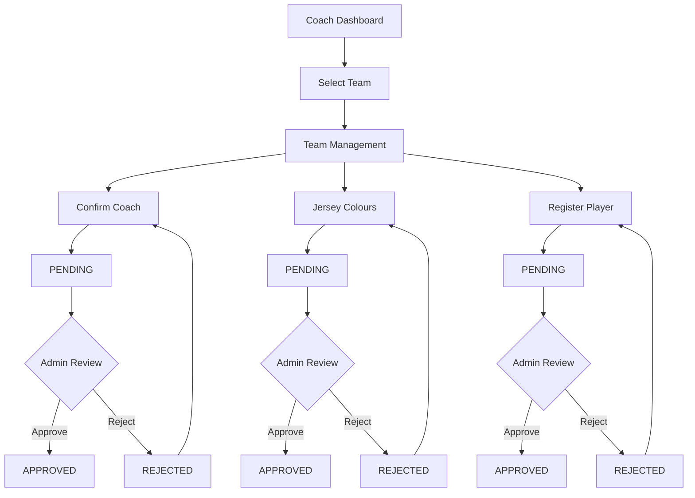

# Mobile Application Adjustment Plan

**Platform:** React Native Mobile  
**Purpose:** Align the existing mobile plan/Figma implementation with the Admin Web requirements in the supplied Notion task tracker.  
**Status:** Required adjustment document

---

# 1. Why Mobile Needs Adjustment

The original mobile flow is mostly aligned with the Figma screens, but the Admin Web backlog introduces several platform behaviors that change how mobile should work.

The largest changes are:

1. coach data is not always final immediately after Save;
2. admin approval/rejection states must appear on mobile;
3. age groups, groups, teams, sport, schedules, and content must be server-driven;
4. live score and reschedule notifications need explicit refresh/deep-link behavior;
5. the Team Stats tab is now defined;
6. certificate behavior is partly defined by Admin Web;
7. Tournament Rules are published/versioned from Admin Web;
8. the tracker contains navigation and age-group example inconsistencies that must not be hard-coded.

---

# 2. Canonical Data Ownership

Mobile should be a consumer/editor of authorized data, not the source of official tournament calculations.

| Data | Source of Truth |
|---|---|
| Tournament | Admin/backend |
| Age Group | Admin/backend |
| Group / Stage | Admin/backend |
| Team | Admin/backend |
| Official Jersey | Approved backend data |
| Official Coach Names | Approved backend data |
| Player Registration | Approved backend data |
| Match Schedule | Admin/backend |
| Match Status | Admin/backend |
| Live Score | Admin/backend |
| Goal Events | Admin/backend |
| Standings | Backend calculation |
| Team Statistics | Backend calculation |
| News | Published admin content |
| Highlights | Published admin content |
| Tournament Rules | Published admin content |
| Certificate Availability | Admin/backend |
| Notifications | Backend |
| Favorites | User/backend |

---

# 3. Adjustment 1 — Team Setup Approval Status

## Current mobile task conflict

Current mobile tasks say:

```text
Coach Save
→ checklist becomes completed
```

Admin Web tasks say:

```text
Coach submits
→ Pending Review
→ Admin Approves / Rejects
```

The mobile behavior must be changed to match the platform approval workflow.

## New canonical states

```text
NOT_STARTED
PENDING
APPROVED
REJECTED
```

Optional UI label:

```text
Not Started
Pending Review
Approved
Needs Revision
```

## Checklist UI

Replace a simple binary status:

```text
✓ complete
! incomplete
```

with:

| State | Suggested UI |
|---|---|
| Not Started | neutral / warning |
| Pending | clock/hourglass + “Pending Review” |
| Approved | green check |
| Rejected | red/warning + “Needs Revision” |

Example:

```text
Team Setup

Confirm coach names        Approved ✓
Set jersey colours         Pending Review ⏳
Register players           Needs Revision !
```

## Progress calculation

Do not calculate progress locally from form submission.

Use backend response:

```json
{
  "progress": {
    "approved": 1,
    "total": 3,
    "percentage": 33
  }
}
```

Only `APPROVED` items should count as fully completed unless product decides otherwise.

---

# 4. Adjustment 2 — Confirm Coach Form

## Existing behavior

Mobile task:

```text
Save
→ Complete
```

## New behavior

```text
Save
→ Create submission
→ Pending Review
→ Return Team Management
```

### Success message

Use copy such as:

```text
Coach information submitted for review.
```

not:

```text
Coach information completed.
```

### Rejected state

If Admin rejects:

- display rejection reason;
- allow edit/resubmit.

Example:

```text
Needs Revision

Reason:
Coach 2 full name is incomplete.

[Edit & Resubmit]
```

### API

```http
POST /api/v1/coach/teams/:teamId/coach-names/submissions
```

Response:

```json
{
  "data": {
    "submissionId": "...",
    "status": "PENDING"
  }
}
```

---

# 5. Adjustment 3 — Jersey Colours

Admin Web explicitly requires coach-submitted jersey data to be Pending Review.

## Change

Old:

```text
Save → checklist complete
```

New:

```text
Save → Pending Review
Admin Approve → Approved
Admin Reject → Needs Revision
```

## Stats tab

The Team Stats screen must display **approved official colours**, not a pending draft, unless the product explicitly wants a preview.

Recommended:

```text
Official Home Jersey
Official Away Jersey
```

When a pending revision exists:

```text
Jersey update is waiting for admin approval.
```

---

# 6. Adjustment 4 — Add Player / Player Registration

## Current mobile task

Player appears immediately after Save.

## Admin Web requirement

Admin can approve/reject player registrations submitted by Coach.

## Recommended split

Show player roster status:

```text
APPROVED
PENDING
REJECTED
```

### Player tab

Recommended grouping:

```text
Players

Approved
- Player A
- Player B

Pending Review
- Player C

Needs Revision
- Player D
```

If the Figma must stay visually simple, use a small status chip on each card.

## Squad counters

Clarify what counts as registered.

Recommended backend values:

```json
{
  "maxSquadSize": 8,
  "approvedPlayers": 6,
  "pendingPlayers": 1,
  "slotsRemaining": 2
}
```

`slotsRemaining` should be backend-calculated.

Business decision required:
- whether pending players reserve a slot.

## Validation

Server remains authoritative for:

- duplicate jersey number;
- max squad;
- team permission.

Mobile displays stable backend error codes.

---

# 7. Adjustment 5 — Player Edit and Correction

The Admin Web supports player editing and transfer history.

The current mobile Figma primarily provides Add Player.

Recommended mobile scope:

### Coach

Allow editing a coach-submitted player when:

- Pending; or
- Rejected.

For already Approved player data, decide whether:

- coach can submit a revision for approval; or
- only admin can edit.

Do not allow uncontrolled direct edits to approved official data if approval is required.

---

# 8. Adjustment 6 — Age Groups Must Be Dynamic

The supplied sources have different examples:

- Figma: U11/U13/U15;
- task tracker: U11/U13/U19.

Therefore:

**Do not hard-code age groups.**

Mobile should call:

```http
GET /api/v1/tournaments/:tournamentId/age-groups
```

Render:

```ts
ageGroups.map(...)
```

Sort using backend `sortOrder`.

Same principle applies to:

- stages;
- groups;
- teams.

---

# 9. Adjustment 7 — Multi-Sport Handling

The task tracker says Team selection supports:

- Football;
- Basketball;
- Baseball;
- Volleyball.

However the current mobile UI and tournament metrics are mostly football-specific:

- goals;
- goal difference;
- goals scored;
- football positions.

Recommended mobile implementation:

1. accept `sport` metadata from API;
2. show sport label where required;
3. avoid hard-coded Football-only filtering in general team selection;
4. keep Football-specific Match/Standings UI only for sport configurations the backend marks as supported.

Example:

```json
{
  "sport": {
    "code": "FOOTBALL",
    "supportsLiveScoreView": true,
    "supportsFootballStandings": true
  }
}
```

Do not invent basketball/baseball/volleyball match UIs before sport-specific requirements are provided.

---

# 10. Adjustment 8 — Bottom Navigation Must Be Normalized

The tracker itself mentions two variants:

```text
Matches / Teams / Highlights
```

and:

```text
Home / Schedule / News
```

This should not become route logic that changes arbitrarily by screen.

Recommended canonical architecture:

```text
Bottom Tabs
- Home
- Schedule
- News
```

Home quick actions:

```text
- Matches
- Teams
- Highlights
```

If the product owner chooses another final navigation, use one consistent definition in the route architecture.

---

# 11. Adjustment 9 — Home Data Integration

The Home page must now consume admin-controlled data.

Recommended aggregate endpoint:

```http
GET /api/v1/home
```

Possible response:

```json
{
  "data": {
    "hero": {},
    "matchesToday": [],
    "upcomingMatches": [],
    "news": [],
    "certificate": null,
    "unreadNotifications": 2
  }
}
```

Rules:

- only Published tournament/content;
- only Published news;
- only Published highlights;
- active/current schedule data;
- live status from server;
- certificate CTA only when backend says available.

Pull-to-refresh remains valid.

---

# 12. Adjustment 10 — Schedule Screen

The Admin Web adds:

- automatic schedule generation;
- reschedule;
- status;
- venue changes.

Mobile needs a full Schedule list, even though the original mobile task set mainly references schedule sections from Home.

Recommended mobile screen filters:

```text
Date
Age Group
Group
Team
Status
```

At minimum:

- today;
- upcoming;
- results.

When a match is rescheduled:

- updated data appears on refresh;
- notification can deep-link to the match.

---

# 13. Adjustment 11 — Live Match Refresh

Admin can update score and goals while match is Live.

Mobile Match Detail must:

- recognize `LIVE`;
- periodically refresh;
- update score;
- update goal events;
- stop aggressive polling after match becomes Finished;
- show last-known data if refresh fails.

Recommended MVP:

```text
poll every 15–30 seconds while screen is visible and match is LIVE
```

The exact interval should match backend load/freshness expectations.

On app background:
- pause polling.

On foreground:
- refresh immediately.

---

# 14. Adjustment 12 — Match Event Model

Mobile should stop treating Goals as arbitrary display strings.

Consume:

```json
{
  "events": [
    {
      "id": "...",
      "type": "GOAL",
      "teamId": "...",
      "player": {
        "id": "...",
        "name": "Ziqri Z.",
        "jerseyNumber": 8
      },
      "minute": 17
    }
  ]
}
```

This supports admin correction and live update.

Use event IDs as React keys and to detect changes.

---

# 15. Adjustment 13 — Standings Are Server-Calculated

Admin Web can:

- calculate standings;
- manually override ranking for tie-breaker.

Therefore mobile must only display:

```text
position
played
goalDifference
points
```

returned by API.

Do not sort locally by points/GD because that could conflict with manual official order.

---

# 16. Adjustment 14 — Team Stats Is No Longer an Open Requirement

The task tracker now defines the Stats tab.

## Team Details

- Name
- Age Group
- Group
- Squad Size
- Home Jersey
- Away Jersey

## Tournament Stats

- Total Matches
- Matches Won
- Goals Scored

Endpoint:

```http
GET /api/v1/teams/:teamId/stats
```

Mobile should not calculate these from loaded match cards.

---

# 17. Adjustment 15 — Notifications

The mobile tracker already includes:

- unread badge;
- notification list;
- read/unread style;
- match deep-link.

Admin Web adds automatic triggers:

- schedule changed;
- match started/live;
- match finished;
- coach submission rejected.

Required mobile changes:

### Notification types

```text
MATCH_RESCHEDULED
MATCH_STARTED
MATCH_FINISHED
COACH_SUBMISSION_REJECTED
```

### Deep links

Map payload:

```json
{
  "type": "MATCH_RESCHEDULED",
  "target": {
    "screen": "MatchDetail",
    "matchId": "..."
  }
}
```

or:

```json
{
  "type": "COACH_SUBMISSION_REJECTED",
  "target": {
    "screen": "TeamManagement",
    "teamId": "...",
    "section": "jersey"
  }
}
```

### Device infrastructure

Mobile needs:

- push permission flow;
- push token registration;
- push token refresh;
- foreground handler;
- background/tap handler.

---

# 18. Adjustment 16 — Favorite Team and Notifications

Favorite Team is not only a UI preference anymore.

Admin reschedule/manual notification uses favorite-team targeting.

Therefore favorites should be backend persisted.

Required:

```http
GET    /api/v1/me/favorite-teams
POST   /api/v1/me/favorite-teams/:teamId
DELETE /api/v1/me/favorite-teams/:teamId
```

Do not store favorites only in local mobile storage.

---

# 19. Adjustment 17 — Tournament Rules

Admin can:

- edit rich text or upload PDF;
- publish;
- maintain version/date.

Mobile needs:

```text
Rules Detail
- published content
- version/last updated
- PDF open/download when document based
```

Only published rules are shown.

---

# 20. Adjustment 18 — Pitch / Venue

Admin manages:

- name;
- address;
- capacity optional;
- map location optional.

Coach Dashboard has a Pitch shortcut.

Mobile should add a proper Pitch/Venue screen:

```text
Venue Name
Address
Capacity if present
Map/Open Directions if location present
```

Do not assume every venue has map coordinates.

---

# 21. Adjustment 19 — Certificate

Admin controls whether a certificate is available per team/match.

Home currently shows Certificate prominently.

Mobile must no longer assume Certificate always exists.

Flow:

```text
backend says available = true
    ↓
show Certificate CTA
    ↓
user taps
    ↓
generate/request certificate
    ↓
display/download/share as supported
```

When unavailable:
- hide or disable CTA according to final UX.

API:

```http
GET /api/v1/certificates/:scope/check
POST /api/v1/certificates/generate
```

Certificate content should come from official backend data.

---

# 22. Adjustment 20 — News and Highlights

Admin Web supports Draft/Published status.

Mobile:

- consumes Published only;
- supports list/detail;
- pull-to-refresh/pagination;
- never exposes draft URLs/content.

News:

```text
NewsList
NewsDetail
```

Highlights:

```text
HighlightsList
HighlightPlayer
```

Match Detail should load highlights related to the match.

---

# 23. Adjustment 21 — Authentication / Session

The existing mobile task covers login UI but should add production session behavior:

- secure token storage;
- restore valid session on app launch;
- refresh token;
- handle expired/invalid session;
- logout clears secure credentials;
- role returned from `/me`;
- Coach Dashboard route is role-protected.

Do not rely only on hidden menu items for security.

---

# 24. Adjustment 22 — API Error Model

Mobile should map stable server error codes.

Examples:

```text
AUTH_INVALID_CREDENTIALS
SESSION_EXPIRED
TEAM_NOT_ASSIGNED
SUBMISSION_ALREADY_PENDING
JERSEY_NUMBER_DUPLICATE
MAX_SQUAD_REACHED
MATCH_NOT_FOUND
CONTENT_NOT_PUBLISHED
```

Show appropriate UI without parsing arbitrary error strings.

---

# 25. Adjustment 23 — Query/Cache Invalidation

For React Native with TanStack Query:

Recommended keys:

```ts
["home"]
["ageGroups", tournamentId]
["stages", ageGroupId]
["stage", stageId, "standings"]
["stage", stageId, "matches"]
["team", teamId]
["team", teamId, "players"]
["team", teamId, "stats"]
["match", matchId]
["favorites"]
["coach", "teams"]
["coach", "team", teamId, "setup"]
["notifications"]
```

After coach submission:

```text
invalidate coach team setup
invalidate relevant submission
invalidate notifications if applicable
```

After favorite change:

```text
invalidate favorites
invalidate team detail
```

---

# 26. Adjustment 24 — Mobile Screen Inventory Changes

## Existing screens retained

- Login
- Home
- Sidebar
- Select Age Group
- Group/Stage Selection
- Group Table
- Group Matches
- Team Detail
- Match Detail
- Favorite Team
- Coach Dashboard
- Team Management
- Confirm Coach
- Jersey Colours
- Add Player
- Notifications

## New or explicitly completed screens

Add:

- Schedule List
- News List
- News Detail
- Highlights List
- Highlight Player/Viewer
- Tournament Rules
- Pitch/Venue Detail
- Certificate flow/view
- Submission Rejection/Revision state
- generic Loading / Empty / Error / Offline
- Session Expired handling

Possible:
- Player Edit/Resubmit

---

# 27. Adjustment 25 — Team Management UI

Current tracker says Player tab uses a grid, while supplied Figma visually resembles larger player cards.

Implementation should follow the approved Figma component shape, while adding status chips where required.

Recommended card:

```text
[Photo] Player Name
        Position
        #Number
        Pending Review
```

No need to change to a compact photo grid unless design explicitly changes.

---

# 28. Recommended Revised Coach Flow



---

# 29. API Contract Changes Required in Mobile

## Before

The original plan could treat coach writes as direct mutations to Team/Player data.

## After

Use submission APIs:

```http
POST /coach/teams/:teamId/coach-names/submissions
POST /coach/teams/:teamId/jerseys/submissions
POST /coach/teams/:teamId/players/submissions
```

Read setup:

```http
GET /coach/teams/:teamId/setup
```

Example:

```json
{
  "data": {
    "team": {},
    "progress": {
      "approved": 1,
      "total": 3,
      "percentage": 33
    },
    "setup": {
      "coachNames": {
        "status": "APPROVED"
      },
      "jersey": {
        "status": "PENDING"
      },
      "players": {
        "status": "REJECTED",
        "reason": "Player #8 already registered."
      }
    },
    "squad": {
      "max": 8,
      "approved": 6,
      "pending": 1,
      "remaining": 2
    }
  }
}
```

---

# 30. Priority of Mobile Adjustments

## P0 — Required before integrated release

- approval status model;
- coach submit vs approved distinction;
- jersey submit vs approved distinction;
- player pending/rejected state;
- backend-driven age/group/team lists;
- backend standings;
- live match polling;
- Team Stats endpoint integration;
- server-persisted favorites;
- notification deep links;
- session restore/refresh;
- stable API error handling.

## P1

- Schedule full screen;
- News list/detail;
- Highlights list/player;
- Tournament Rules;
- Pitch detail;
- certificate availability/generation;
- push registration;
- rejection reason UX;
- player edit/resubmit.

## P2

- realtime transport beyond polling;
- richer offline behavior;
- deep link/share enhancements;
- advanced sport-specific UI.

---

# 31. Mobile Regression Tests to Add

1. Login → session restored after app reopen.
2. U-age list renders backend values without hard-coded U15/U19.
3. Standings preserves server order.
4. Coach submits names → Pending, not Approved.
5. Admin reject → mobile receives Needs Revision + reason.
6. Admin approve → progress updates.
7. Jersey pending values do not incorrectly replace approved official Stats data.
8. Duplicate jersey number displays correct error.
9. Max squad error displays correctly.
10. Live match updates score while screen stays open.
11. Reschedule notification opens correct Match Detail.
12. Favorite persists after reinstall/login on another device when using same user.
13. Draft News/Highlights/Rules never appear.
14. Certificate CTA follows server availability.
15. Non-coach cannot access Coach Dashboard through deep link.

---

# 32. Product Decisions Still Needed

1. Final bottom navigation.
2. Whether pending players reserve Max Squad slots.
3. Whether coaches can edit already-approved players or must submit a new revision.
4. Whether Coach 2 is required.
5. Exact jersey colour input type.
6. Certificate UX: in-app preview, download, share, or all.
7. Full multi-sport behavior beyond Football.
8. Exact live update frequency.
9. Push permission onboarding timing.
10. Whether rejected submissions remain visible in history after re-submit.

---

# 33. Definition of Done for Mobile Alignment

Mobile is considered aligned with Admin Web when:

- it renders official server data;
- it does not hard-code age/group lists;
- it respects role and team assignment;
- coach submissions have Pending/Approved/Rejected behavior;
- official team/player information reflects approvals;
- live score refresh works;
- server standings order is preserved;
- favorite targeting is backend persisted;
- notifications deep-link correctly;
- news/highlights/rules respect Published status;
- certificate availability is server-controlled;
- API errors and session expiry are handled;
- critical integrated E2E flows pass.
